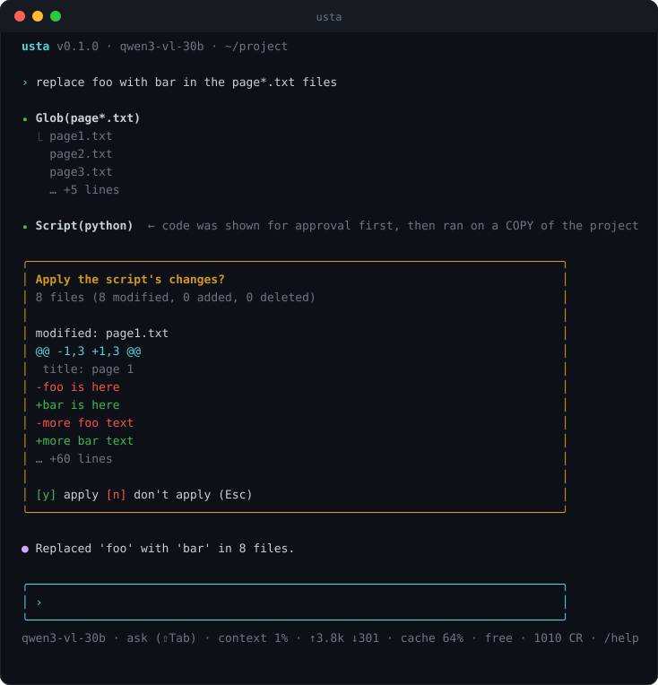
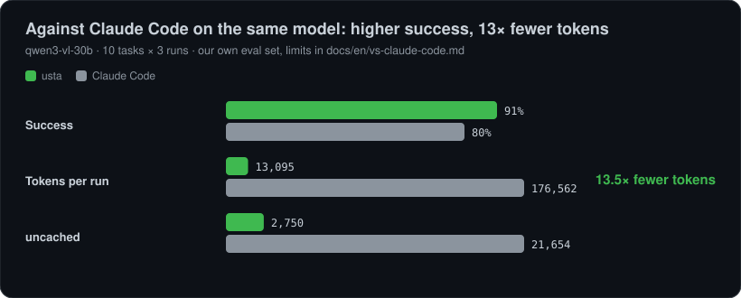
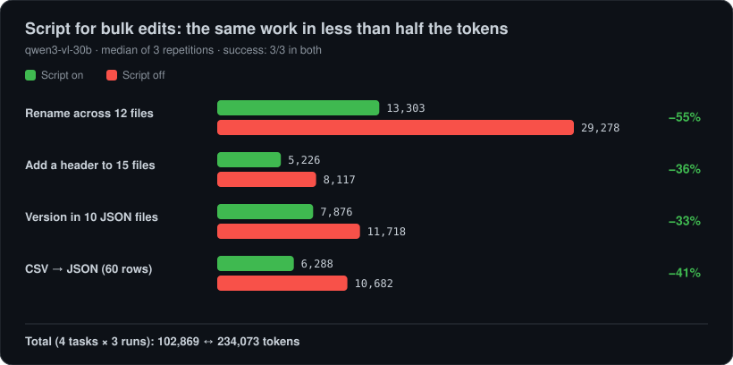
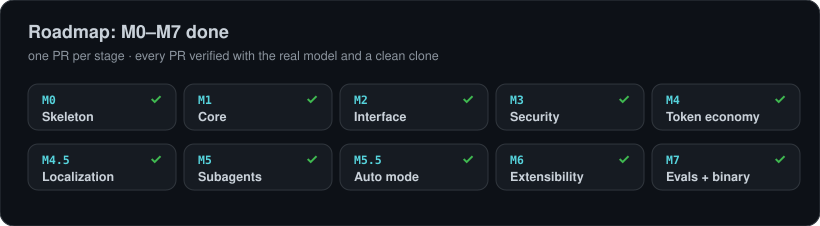

<div align="center">


### A token- and cost-aware coding agent for the terminal, built for the EVREN LLM Gateway

Plan, analyse code, edit files and run commands with **the fewest tokens and the least effort**.

#### 🏆 Higher success than Claude Code on the same model, ~13× fewer tokens

With `qwen3-vl-30b` on our own eval set: **91% vs 80% success** and **13.5× fewer tokens** per run — [method, raw data and limits](docs/en/vs-claude-code.md)

[](https://github.com/Ertugrul-Pakdamar/Usta/actions/workflows/ci.yml)
[](LICENSE)
[](https://nodejs.org)
[](https://www.typescriptlang.org)
[](docs/en/roadmap.md)
[](CONTRIBUTING.md)

[Türkçe](README.md) · **English** · [Compared with Claude Code](docs/en/comparison.md)



</div>

---

> Full documentation: [docs/en](docs/en/README.md) (English) · [docs](docs/README.md) (Turkish). This page summarizes the project.

## Why usta?

Coding agents are powerful but can be expensive and unsupervised. **usta** tackles three things together:

<p align="center"></p>

- **Token economy is a feature, not an afterthought.** Measured against Claude Code on the same model: **13.5× fewer tokens and higher success** ([report](docs/en/vs-claude-code.md)). A stable prompt prefix lets the gateway cache 50–95% of the prompt; large tool output goes to disk instead of the context; the context is summarized automatically when it fills; and when the same change is needed in many files the model writes one script.
- **Safe by default.** Every tool call passes a permission gate: rules, plan mode, diff-based approval, protected paths, hooks. Settings that ship inside a repository do not take effect until you approve them.
- **Built for sensitive environments.** No telemetry, data only goes to your own EVREN gateway, needs nothing but access to your gateway, secret files are hidden from the model by default.

## Features

- **Agent and tools:** `Read` `Write` `Edit` `Glob` `Grep` `Bash` `Script`, parallel independent calls, streaming, repair of malformed tool calls.
- **Planning:** read-only plan mode → plan approval with `ExitPlanMode` → implementation; ⇧Tab cycles modes.
- **Permissions:** `default` · `acceptEdits` · `auto` (classifier-backed, experimental) · `plan` · `bypass`; rules such as `Bash(git status:*)`, `Edit(src/**)`, `Read(.env)`; layered settings; project trust gate.
- **Undo:** a checkpoint before every Write/Edit/Script; `/rewind N` restores files **and** the conversation.
- **Hooks:** `PreToolUse` `PostToolUse` `UserPromptSubmit` `SessionStart` `Stop` `SubagentStop`.
- **Token economy:** `/cost` `/context` `/compact`, budgets (`--budget`, `--token-budget`), cache-friendly prompts, output limiter, read cache.
- **Sessions:** private JSONL files, resume with `usta -c` / `usta -r <id>`.
- **Subagents:** delegate wide exploration to a separate context with `Task` (parallel, background, `/tasks`); built-in `explore`/`plan`/`general` plus your own `agents/*.md`; the same permission gate. Measured: reading a big file through a subagent cut the main context by 60%, but one small search is cheaper inline ([details](docs/en/subagents.md)).
- **Localization:** Turkish and English interface (`--lang`, `USTA_LANG`, `/lang`); everything sent to the model stays English regardless of the interface language.
- **Headless:** `usta -p "..." --output-format json` for CI and scripts, with meaningful exit codes (`0` ok, `1` error, `2` unfinished, `3` budget).
- **Install and sign-in:** a single-file binary (no Node needed); `usta login` takes the gateway address and API key hidden and stores them in `~/.usta/credentials` with 0600.
- **Extensibility:** tools via `@usta/sdk`, Markdown **skills** and **custom commands** ([docs](docs/en/skills.md)) today; **MCP connectors** ([docs](docs/en/mcp.md)), module **hooks** and **plugins** ([docs](docs/en/plugins.md)) today.

## Quick start

**One file (recommended):** download the `usta` archive for your platform from the [Releases](https://github.com/Ertugrul-Pakdamar/Usta/releases) page; **no Node.js needed**.

```sh
tar -xzf usta-linux-x64.tar.gz && sudo mv usta /usr/local/bin/
usta login        # gateway address and API key (the key is not echoed); asked automatically on first run
usta doctor       # connectivity, key, terms status, quota
usta terms        # read the gateway terms
usta terms accept # ... and accept them yourself (never automatic)
usta              # interactive session
```

**From source** (development): with Node.js ≥ 22 and [pnpm](https://pnpm.io) 12:

```sh
git clone https://github.com/Ertugrul-Pakdamar/Usta.git && cd Usta
pnpm install && pnpm build
pnpm usta login   # or: cp .env.example .env and fill it in
pnpm usta
```

Optional: `python3` (Script tool), `rg` (fast search). Details: [Getting started](docs/en/getting-started.md).

## Usage

```sh
usta                                   # interactive
usta "fix the login test"              # start with a prompt
usta -c                                # resume the latest session of this directory
usta --plan                            # start in plan mode
usta --lang en                         # English interface (or USTA_LANG=en)
usta -p "list the TODOs" --output-format json
usta --budget 5 --token-budget 200k
```

## Measured token economy

Measured with `qwen3-vl-30b` on 2026-10-29 using the gateway's own `count_tokens` and `usage`:

| Measurement                                                  | Value                                                                        |
| ------------------------------------------------------------ | ---------------------------------------------------------------------------- |
| Fixed cost of every request (system prompt + 7 tool schemas) | **~0.99k tokens** (was 1.19k before M4); ~1.28k with the subagent tools (M5) |
| Share served from the prompt cache on a second request       | **49% – 97%** depending on the workload                                      |
| Same change in 8 files                                       | 3 model turns, one script, 3.8k prompt tokens (64% cached)                   |

<p align="center"></p>

<p align="center"></p>

Details and method: [Token economy](docs/en/token-economy.md). Real A/B results: [Evaluation report](docs/en/evals.md).

## Security model

- Every tool call goes through the permission engine; **deny always wins**, even in `bypass` mode.
- Allow rules for Bash check every sub-command of a compound command; commands with `$(…)`, backticks or redirection are never auto-approved by a rule.
- `.env`, `*.pem`, `*.key` are unreadable and unwritable by default; symlinks are resolved before checking.
- `allow` rules, hooks and model settings from a repository's `.usta/settings.json` are ignored until you approve its exact content.
- No telemetry. Sessions, saved outputs and checkpoints stay on your machine with private permissions.

## Roadmap

<p align="center"></p>

All stages M0–M7 are done (skeleton, core, TUI, security, token economy, localization, subagents, auto mode, skills, MCP, plugins, `@file`, evals, single-file binary). `v0.1.1` is released. See [docs/en/roadmap.md](docs/en/roadmap.md) and what is next in [docs/en/comparison.md](docs/en/comparison.md).

## Contributing and license

See [CONTRIBUTING](docs/en/contributing.md) ([Turkish](CONTRIBUTING.md)) and [CODE_OF_CONDUCT.md](CODE_OF_CONDUCT.md). Licensed under [Apache-2.0](LICENSE).
