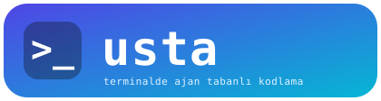
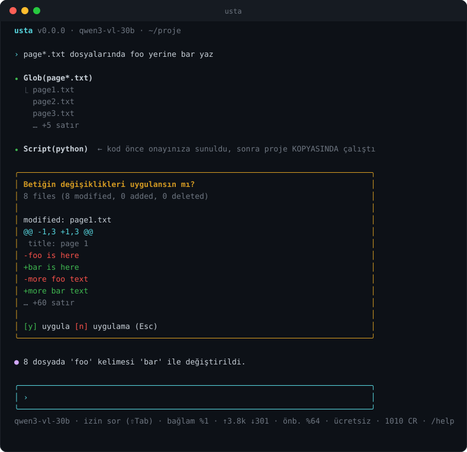
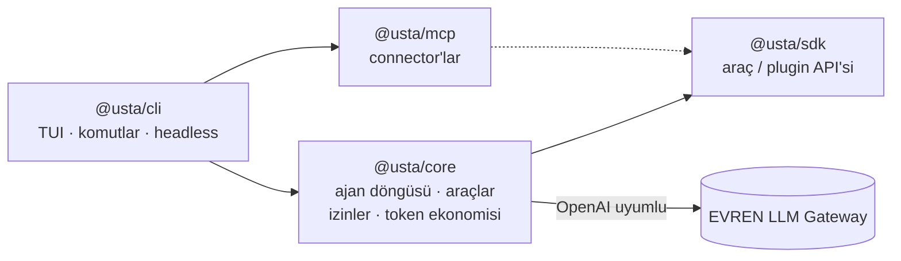
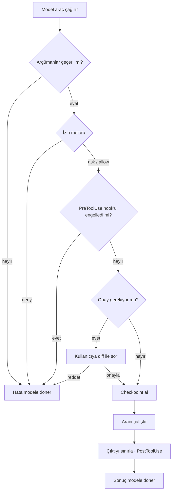
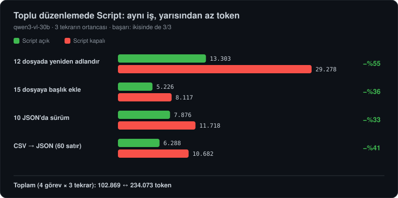
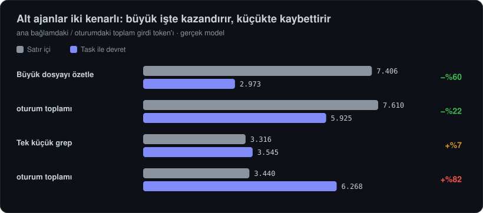
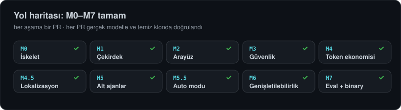

<div align="center">



### EVREN LLM Gateway için terminalde çalışan, token ve maliyet bilinciyle tasarlanmış kodlama ajanı

Planlama, kod analizi, dosya düzenleme ve terminal erişimini **en az token, en az emekle** yapın.

[](https://github.com/Ertugrul-Pakdamar/Usta/actions/workflows/ci.yml)
[](LICENSE)
[](https://nodejs.org)
[](https://www.typescriptlang.org)
[](docs/roadmap.md)
[](CONTRIBUTING.md)

**Türkçe** · [English](README.en.md) · [Docs (English)](docs/en/README.md)

[Hızlı başlangıç](#hızlı-başlangıç) · [Belgeler](docs/README.md) · [Mimari](docs/architecture.md) · [Yol haritası](docs/roadmap.md) · [Katkı](CONTRIBUTING.md)



</div>

---

## Neden usta?

Kod ajanları güçlüdür ama pahalı ve denetimsiz olabilir. **usta** üç şeyi birlikte çözmek için yazıldı:

- **Token ekonomisi bir özellik, sonradan eklenen bir iyileştirme değil.** Sabit istem öneki sayesinde gateway önbelleği %50–95 isabet verir; büyük çıktılar bağlama sığdırılmaz, diske yazılır; bağlam dolunca otomatik özetlenir; aynı değişiklik çok dosyada gerekiyorsa model tek bir betik yazar.
- **Güvenlik varsayılan.** Her araç çağrısı bir izin kapısından geçer: kurallar, plan modu, diff'li onay, korunan yollar, hook'lar. Repodan gelen ayarlar siz onaylamadan çalışmaz.
- **Savunma sanayi bağlamına uygun.** Telemetri yok, veri yalnızca sizin EVREN gateway'inize gider, çalışmak için yalnızca gateway erişimi yeter, gizli dosyalar varsayılan olarak modelden saklanır.

## Özellikler

|                         |                                                                                                                                                                                                                                  |
| ----------------------- | -------------------------------------------------------------------------------------------------------------------------------------------------------------------------------------------------------------------------------- |
| **Ajan ve araçlar**     | `Read` `Write` `Edit` `Glob` `Grep` `Bash` `Script`; bağımsız çağrılar paralel; akışlı cevap; bozuk araç çağrısı onarımı                                                                                                         |
| **Planlama**            | Plan modu (salt okuma) → `ExitPlanMode` ile plan onayı → uygulama; ⇧Tab ile mod değiştirme                                                                                                                                       |
| **İzinler**             | `default` · `acceptEdits` · `auto` (sınıflandırıcılı, deneysel) · `plan` · `bypass`; `Bash(git status:*)`, `Edit(src/**)`, `Read(.env)` kuralları; katmanlı ayar dosyaları; proje güven kapısı                                   |
| **Geri alma**           | Her Write/Edit/Script öncesi checkpoint; `/rewind N` dosyaları **ve** konuşmayı geri alır                                                                                                                                        |
| **Hook'lar**            | `PreToolUse` `PostToolUse` `UserPromptSubmit` `SessionStart` `Stop` `SubagentStop`; kabuk komutu, JSON protokolü                                                                                                                 |
| **Token ekonomisi**     | `/cost` `/context` `/compact`; bütçe (`--budget`, `--token-budget`); önbellek dostu istem; çıktı sınırlayıcı; okuma önbelleği                                                                                                    |
| **Oturumlar**           | JSONL, 0600 izinli; `usta -c` / `usta -r <id>` ile devam; otomatik özet devamda da geçerli                                                                                                                                       |
| **Alt ajanlar**         | `Task` ile geniş keşfi ayrı bağlamda yürüt (paralel, arka plan, `/tasks`); dahili `explore`/`plan`/`general` ve kendi `agents/*.md` ajanların; aynı izin kapısı                                                                  |
| **Dil**                 | Türkçe ve İngilizce arayüz ve belgeler (`--lang`, `USTA_LANG`, `/lang`); modele giden metin dilden bağımsız, sabit İngilizce                                                                                                     |
| **Headless**            | `usta -p "..." --output-format json` — CI ve betikler için; çıkış kodları anlamlı                                                                                                                                                |
| **Kurulum ve giriş**    | Tek dosya binary (Node gerekmez); `usta login` ile gateway adresi ve API anahtarı gizli girilir, `~/.usta/credentials`'a 0600 ile yazılır                                                                                        |
| **Genişletilebilirlik** | `@usta/sdk` ile araç tanımlama, Markdown **skill'leri** ve **özel komutlar** ([docs](docs/skills.md)) bugün; **MCP connector'ları** ([docs](docs/mcp.md)), modül **hook'ları** ve **plugin**'ler ([docs](docs/plugins.md)) bugün |

## Hızlı başlangıç

**Tek dosya (önerilen):** [Sürümler](https://github.com/Ertugrul-Pakdamar/Usta/releases) sayfasından platformunuza uygun `usta` arşivini indirin; **Node.js gerekmez**.

```sh
tar -xzf usta-linux-x64.tar.gz && sudo mv usta /usr/local/bin/
usta login        # gateway adresi ve API anahtarı (anahtar ekrana yazılmaz); ilk çalıştırmada kendiliğinden sorulur
usta doctor       # bağlantı, anahtar, şart kabulü, kota
usta terms        # kullanım şartlarını okuyun
usta terms accept # ... ve kabul ediyorsanız onaylayın (siz yazarsınız, otomatik kabul yok)
usta              # etkileşimli oturum
```

**Kaynaktan** (geliştirme): Node.js ≥ 22 ve [pnpm](https://pnpm.io) 12 ile:

```sh
git clone https://github.com/Ertugrul-Pakdamar/Usta.git && cd Usta
pnpm install && pnpm build
pnpm usta login   # ya da: cp .env.example .env ve değerleri doldurun
pnpm usta
```

İsteğe bağlı: `python3` (Script aracı), `rg` (hızlı arama). Ayrıntılar: [Başlangıç](docs/getting-started.md).

## Kullanım

```sh
usta                                   # etkileşimli oturum
usta "login testini düzelt"            # istemle başlat
usta -c                                # bu dizindeki son oturuma devam et
usta --plan                            # plan modunda başla
usta --lang en                         # arayüzü İngilizce aç (USTA_LANG=en de olur)
usta -p "TODO'ları listele" --output-format json
usta --budget 5 --token-budget 200k    # sınırlı oturum
usta -p "..." --allow 'Bash(pnpm test:*)' --deny 'Read(.env)'
```

Oturum içinde `/help` tüm komutları listeler:

| Komut                                              | Ne yapar                                                               |
| -------------------------------------------------- | ---------------------------------------------------------------------- |
| `/plan`, `/mode`                                   | Plan moduna geçer, izin modunu gösterir/değiştirir (⇧Tab ile de döner) |
| `/auto`                                            | Auto modunun son kararlarını ve sayılarını gösterir                    |
| `/plugins`                                         | Kurulu plugin'leri listeler                                            |
| `/mcp`                                             | Bağlı MCP sunucularını ve araçlarını gösterir                          |
| `/skills`                                          | Yüklü skill'leri ve özel komutları listeler                            |
| `/context`                                         | Bağlam penceresinin neye gittiğini gateway'in tam sayımıyla gösterir   |
| `/cost`                                            | Token, önbellek isabeti, kalan kredi, günlük kota ve bütçe             |
| `/compact [odak]`                                  | Eski turları özetleyip bağlamı küçültür                                |
| `/rewind [N]`                                      | Son N turun dosya değişikliklerini ve konuşmayı geri alır              |
| `/tasks`                                           | Alt ajan görevlerini listeler; `/tasks show <id>`, `/tasks stop <id>`  |
| `/permissions`                                     | Geçerli kuralları, hook'ları ve ayar dosyalarını gösterir              |
| `/model`, `/models`, `/clear`, `/session`, `/exit` | Model, konuşma ve oturum yönetimi                                      |
| `!komut`                                           | Doğrudan kabuk komutu (modele gitmez)                                  |

## Nasıl çalışır



Her araç çağrısı tek bir kapıdan geçer; ayrıntı için [mimari belgesine](docs/architecture.md) bakın:



## Token ekonomisi, ölçülmüş

Aşağıdaki sayılar `qwen3-vl-30b` ile, gateway'in kendi `count_tokens` ve `usage` değerlerinden alındı (2026-10-29):

| Ölçüm                                                   | Değer                                                                           |
| ------------------------------------------------------- | ------------------------------------------------------------------------------- |
| Her istekteki sabit yük (sistem istemi + 7 araç şeması) | **~0.99k token** (M1–M3'te 1.19k idi); alt ajan araçlarıyla (M5) ~1.28k         |
| Aynı oturumun ikinci isteğinde önbellekten gelen pay    | **%49 – %97** (iş yüküne göre)                                                  |
| 8 dosyada aynı değişiklik                               | 3 model turu, tek betik, 3.8k girdi token'ı (%64 önbellekten)                   |
| 80 KB'lık komut çıktısı                                 | Bağlama ~12k karakter girer, tamamı diske kaydedilir, model `Read` ile açabilir |

<p align="center"></p>

<p align="center"></p>

Ayrıntılar ve yöntem: [Token ekonomisi](docs/token-economy.md). Gerçek A/B sonuçları: [Değerlendirme raporu](docs/evals.md) (toplu düzenlemede Script ile −%56 token, aynı başarı).

## Güvenlik modeli

- Her araç çağrısı izin motorundan geçer; **deny her zaman kazanır**, `bypass` modunda bile.
- Bash allow kuralları bileşik komutlarda her alt komutu doğrular; `$(…)`, kaçış ve yönlendirme içeren komutlar kural ile onaylanmaz.
- `.env`, `*.pem`, `*.key` gibi dosyalar varsayılan olarak okunamaz ve yazılamaz; sembolik bağlantılar çözülerek kontrol edilir.
- Repodan gelen `.usta/settings.json` içindeki `allow` kuralları, hook'lar ve model/özet ayarları **siz içeriği onaylamadan** uygulanmaz.
- Telemetri yoktur. Oturumlar, çıktılar ve checkpoint'ler yalnızca sizin makinenizde, özel izinlerle tutulur.

Ayrıntılar: [İzinler ve güvenlik](docs/permissions.md) · Zafiyet bildirimi: [SECURITY.md](SECURITY.md)

## Durum ve yol haritası

<p align="center"></p>

usta **alfa** aşamasındadır: çekirdek, arayüz, güvenlik ve token ekonomisi tamamlandı.

|     | Aşama                                             | Durum      |
| --- | ------------------------------------------------- | ---------- |
| ✅  | M0–M2 İskelet, çekirdek, TUI                      | Tamamlandı |
| ✅  | M3 Güvenlik: izinler, plan modu, rewind, hook'lar | Tamamlandı |
| ✅  | M4 Token ekonomisi: bütçe, önbellek, özet, Script | Tamamlandı |
| ✅  | M4.5 Lokalizasyon (TR/EN arayüz ve belgeler)      | Tamamlandı |
| ✅  | M5 Subagent'lar ve arka plan görevleri            | Tamamlandı |
| ✅  | M5.5 Auto modu (sınıflandırıcı destekli izin)     | Tamamlandı |
| ✅  | M6 Skill, komut, MCP, plugin, modül hook'ları     | Tamamlandı |
| ✅  | M7 `@dosya`, eval raporu, tek dosya binary, 0.1.0 | Tamamlandı |

Tam liste: [docs/roadmap.md](docs/roadmap.md).

## Depo yapısı

```
packages/
  core/   ajan döngüsü, provider, araçlar, izinler, token ekonomisi, oturumlar
  cli/    Ink arayüzü, komutlar, headless mod
  sdk/    araç/plugin yazarları için genel API
  mcp/    MCP connector istemcisi
docs/     kullanıcı ve geliştirici belgeleri, mimari karar kayıtları (ADR)
```

## Katkı

Katkılar memnuniyetle karşılanır. Başlamak için [CONTRIBUTING.md](CONTRIBUTING.md) dosyasına ve [mimari belgesine](docs/architecture.md) bakın. Davranış kuralları: [CODE_OF_CONDUCT.md](CODE_OF_CONDUCT.md).

```sh
pnpm install && pnpm build
pnpm lint && pnpm test      # PR öncesi ikisi de yeşil olmalı
```

## Lisans

[Apache License 2.0](LICENSE) altında dağıtılır. Bkz. [NOTICE](NOTICE).
