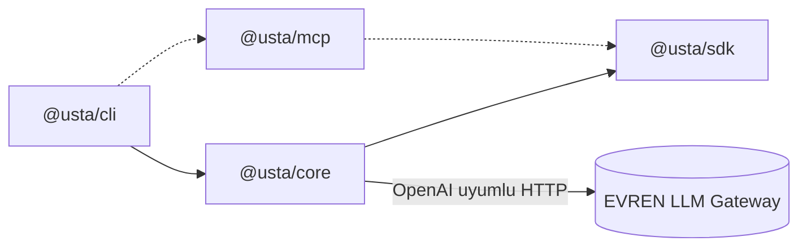
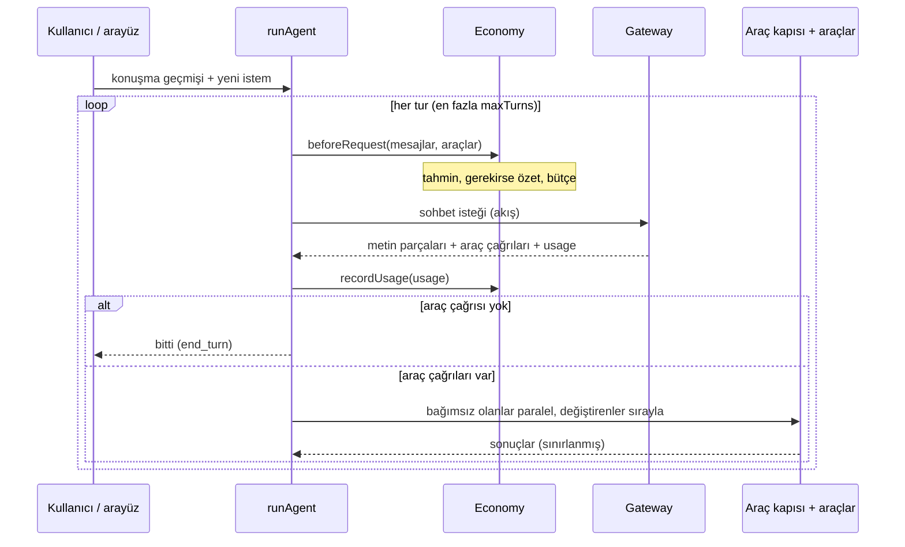
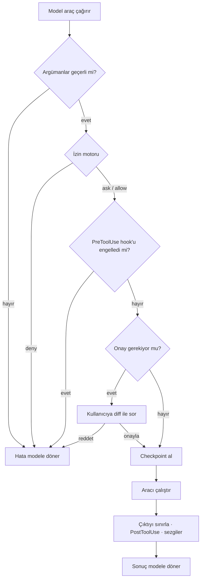

# Mimari

Bu belge usta'nın nasıl kurulduğunu ve **neden** öyle kurulduğunu anlatır. Katkı yapmadan önce okumanız önerilir; kararların gerekçeleri [ADR'lerde](adr/) kayıtlıdır.

## Paketler

| Paket        | Sorumluluk                                                                                                                                | Bağımlı olabileceği  |
| ------------ | ----------------------------------------------------------------------------------------------------------------------------------------- | -------------------- |
| `@usta/sdk`  | **Genel API**: `Tool`, `defineTool`, `ToolError`, `ToolContext`, `ReviewRequest`. Plugin/araç yazarları yalnızca bunu görür               | yalnızca `zod`       |
| `@usta/core` | Arayüzden bağımsız her şey: ajan döngüsü, provider, araçlar, izin motoru, kapı, hook'lar, ayarlar, oturumlar, checkpoint, token ekonomisi | `sdk`                |
| `@usta/cli`  | Ink arayüzü, slash komutları, headless mod, `bin` girişi                                                                                  | `core`, `sdk`, `mcp` |
| `@usta/mcp`  | MCP connector istemcisi _(M6; şimdilik boş)_                                                                                              | `core`, `sdk`        |

**Kural:** `core` arayüzü (Ink/React) hiçbir şekilde bilmez. Böylece aynı çekirdek TUI'ı, headless modu ve ileride bir IDE eklentisini besler. `core`'un dışa açtığı her şey `index.ts` üzerinden gider; `sdk` ise tek kararlı (semver) yüzeydir.

## Ajan döngüsü

`runAgent` (`core/src/agent/loop.ts`) tek bir kullanıcı isteğini bitirene kadar modelle konuşur.

Döngünün önemli sözleşmeleri:

- **Hata modele döner, çökmez.** Geçersiz JSON, bilinmeyen araç, şemaya uymayan argüman, reddedilen izin: hepsi aracın _sonucu_ olarak modele iletilir ve model düzeltebilir.
- **İptal güvenlidir.** Akış iptal edilirse yarım cevap geçmişe yazılmaz; geçmiş her zaman geçerli kalır (her araç çağrısının bir sonucu vardır).
- **Metin olarak gelen araç çağrıları** (`<tool_call>{…}</tool_call>`) yedek ayrıştırıcıyla çağrıya çevrilir; bazı modeller/sunucular native `tool_calls` yerine bunu üretir.
- **Salt okuma çağrıları paralel**, değiştirenler sıralı çalışır.
- Döngü bir **bütçe hatası** fırlatılırsa `stopReason: "budget"` ile temiz biter.

Önemli seçenekler: `tools` (dizi **veya** her turda değerlendirilen fonksiyon), `approve` (her çağrıdan önce), `review` (araçların toplu yazma onayı), `beforeRequest`, `volatileTail`, `limitOutput`, `afterTool`, `onMessage` (kalıcılık), `state` (araçlar arası paylaşılan önbellek).

## Araç sözleşmesi (`@usta/sdk`)

| Alan                  | Anlamı                                                                                   |
| --------------------- | ---------------------------------------------------------------------------------------- |
| `name`, `description` | Modele gider. **İngilizce ve kısa** olmalı: her araç her istekte ~110 token tutar        |
| `input` (zod)         | Hem doğrulama hem model için JSON Schema; tek kaynak                                     |
| `mutating`            | Durum değiştirir mi? Plan modunda yasaklanır, onay gerektirir                            |
| `permission`          | `{ kind: "path" \| "command", target(input) }`: izin kuralları neyle eşleşecek           |
| `preview?`            | Onay kutusunda gösterilecek diff/önizleme                                                |
| `run(input, ctx)`     | `ctx.cwd`, `ctx.signal`, `ctx.state`, `ctx.review`. Beklenen hatada `ToolError` fırlatır |

## Araç kapısı

Her çağrı **tek** bir yoldan geçer (`core/src/gate.ts`); atlamanın bir yolu yoktur.

`Script` gibi kendi başına çok dosya yazan araçlar için kapı, ikinci bir kanal sunar: `ctx.review`. Araç, yazmadan önce tam diff'i ve dosya listesini gönderir; `createReviewer` her dosyayı `Edit`/`Write` kurallarına göre denetler (deny, korunan yol, çalışma dizini dışı), gerekirse kullanıcıya sorar ve dosyaları checkpoint'ler. Gerekçe: [ADR-0003](adr/0003-script-review-in-tool.md).

İzin motoru (`permissions.ts`) saf bir fonksiyon gibidir: aynı kurallar ve girdi, aynı karar. Bu yüzden en yoğun test edilen modüldür.

## Token ekonomisi katmanı

`Economy` (`core/src/economy.ts`) bir konuşmanın token yönetimini tek yerde toplar:

| Parça                                      | Dosya             | İş                                                        |
| ------------------------------------------ | ----------------- | --------------------------------------------------------- |
| `ModelRegistry`                            | `models.ts`       | `/v1/models`'tan pencere, fiyat, yetenek; diskte önbellek |
| `TokenEstimator`, `GatewayTokenCounter`    | `tokens.ts`       | Kalibre tahmin, `count_tokens` ile tam sayım              |
| `CostTracker`, `checkBudget`, `fetchQuota` | `cost.ts`         | Kullanım, önbellek oranı, bütçe, `/v1/quota`              |
| `compactMessages`                          | `compaction.ts`   | Eski turları özetleme                                     |
| `createOutputLimiter`                      | `output-limit.ts` | Büyük çıktıyı kısalt ve diske yaz                         |
| `BulkEditNudge`                            | `nudge.ts`        | Toplu düzenleme sezgisi                                   |

Arayüz (`cli`) `Economy`'yi kurar ve geri çağrılarını (`callbacks`) kendi ihtiyacına bağlar (uyarı göster, bütçe sor, özeti kaydet). Hesap mantığı arayüzde değil çekirdektedir.

## Kalıcı veri biçimleri

**Oturum** (`~/.usta/sessions/<id>.jsonl`): her satır bir JSON nesnesidir, yalnızca eklenir.

| `type`     | Anlamı                                                         |
| ---------- | -------------------------------------------------------------- |
| `meta`     | İlk satır: `id`, `cwd`, `createdAt`, `model`                   |
| `message`  | Bir konuşma mesajı (`user`/`assistant`/`tool`)                 |
| `truncate` | `/rewind`: ilk `length` mesaj kalsın                           |
| `compact`  | Otomatik/elle özet: ilk `keepFrom` mesaj `summary` ile değişti |

Yükleyici satırları sırayla oynatır; yarım yazılmış son satırı yok sayar ve sonuçsuz kalmış son araç çağrısı turunu atar. Sistem istemi saklanmaz (devamda taze üretilir). API anahtarı yazılmadan önce maskelenir.

**Checkpoint** (`~/.usta/checkpoints/<id>/index.json`): her tur için `{messageCount, prompt, files: [{path, backup|null}]}`; yedekler yanında `*.bak`. `backup: null` "dosya yoktu" demektir (geri alınca silinir).

## Arayüz (Ink)

- **`<Static>`** biten öğeleri (kullanıcı/asistan/araç) bir kez basar; yalnızca akan metin, onay kutusu ve giriş alanı yeniden çizilir (titremeyi önler).
- Akan metin 50 ms'de bir güncellenir; en son 20 satırı gösterilir, bittiğinde markdown olarak çizilir.
- Onay (`pending`) ve bütçe sorusu (`confirm`) ayrı durumlardır; açıkken giriş alanı kapalı, tuşlar onay kutusuna gider.
- Yapıştırılan metin tek parça gelir ve içindeki satır sonları _gönderme sayılmaz_.
- Uzun satırlarda önek simgeleri (`›`, `●`) `flexShrink={0}` ile korunur (aksi halde Yoga bunları kırpıyordu).

## Alt ajanlar

`core/src/agents` altında: `definitions.ts` (dahili ve `agents/*.md` özel ajanlar, güven özeti), `runner.ts` (`runSubagent`: yeni bağlamda `runAgent`), `manager.ts` (`TaskManager`: kuyruk, eşzamanlılık, arka plan, bildirim) ve `task-tool.ts` (`Task`, `TaskOutput`).

- **Yalıtım:** Alt ajanın mesajları, araç listesi (`resolveAgentTools`), durumu (`state`) ve okuma önbelleği kendisine aittir; ana konuşmaya yalnızca `formatReport` çıktısı döner.
- **Paylaşılan kapı:** `runSubagent` aynı `PermissionEngine` ile `createToolGate`/`createReviewer` kurar; arka planda `ask` verilmediği için onay gerektiren çağrı reddedilir. Ön plan soruları `serializeAsk` ile tek kuyrukta toplanır.
- **Eşzamanlılık:** `TaskManager` bir sayaç semaforu (en fazla 3) ve yazma yapabilen ajanlar için ayrı bir kilit (1) kullanır.
- **Maliyet:** `Economy.trackSubagentUsage` kullanımı oturum toplamına ekler ama ana bağlamın ölçümüne dokunmaz; `subagentGuard` bütçeyi denetler.
- **Teslimat:** Biten arka plan görevi `drainNotices()` ile bir sonraki turun başında `pendingMessages` üzerinden konuşmaya eklenir.

Gerekçe ve ölçümler: [ADR-0007](adr/0007-subagents.md).

## Auto modu

`core/src/auto` altında: `rules.ts` (yerel tehlikeli-kalıp ve salt okuma listesi), `classifier.ts` (`AutoClassifier`: girdi daraltma, `models.fast` çağrısı, devre kesici, denetim günlüğü), `factory.ts` (oturuma bağlama), `report.ts` (`/auto`).

- **Motor → kapı:** `PermissionEngine.decide` `auto` modunda "sor" yerine `classify` kararı döner; `createToolGate` bunu sınıflandırıcıya götürür. `deny`, korunan yol ve `ask` kuralı sınıflandırıcıdan önce biter.
- **Kapalı başarısızlık:** sınıflandırıcı yoksa, hata verirse ya da `safe` demezse çağrı kullanıcıya sorulur (soracak kimse yoksa reddedilir).
- **Devre kesici:** art arda 3 / toplam 10 `risky`/`unsure` sonrası kapı modu `default`'a çevirir ve uyarır.
- Alt ajanlar aynı sınıflandırıcıyı `SubagentRuntime.auto` ile paylaşır.

Gerekçe ve ölçümler: [ADR-0008](adr/0008-auto-mode.md), kullanıcı rehberi: [Auto modu](auto-mode.md).

## Yerelleştirme (i18n)

usta'daki her metin **iki sınıftan birine** girer ve bu ayrım tasarımın temelidir:

- **Kullanıcıya dönük** (kullanıcının dilinde, `tr`/`en`): arayüz metinleri, onay kutuları, `doctor`/`terms` çıktısı, slash komutu açıklamaları, raporlar (`/cost`, `/context`), uyarılar, komut satırı yardımı. Katalogda yaşar: `core/src/i18n`.
- **Modele dönük** (**sabit İngilizce**): sistem istemi, araç açıklamaları, **araç sonuçları ve hata iletileri**, izin/hook ret sebepleri, özet istemi, ipuçları. Kodda düz metin olarak yaşar.

Modele dönük metin dile bağlanmaz çünkü (1) model her dilde aynı davranmalı, (2) Türkçe daha çok token tüketir, (3) istem önekinin bayt bayt aynı kalması önbellek için şarttır ([ADR-0005](adr/0005-stable-prompt-prefix.md)). Gerekçe ve alternatifler: [ADR-0006](adr/0006-localization.md).

**Katalog.** `en.ts` kaynaktır ve anahtar kümesini (`MessageKey`) tanımlar; `tr.ts` `Record<MessageKey, …>` olduğu için **eksik bir anahtar derlemeyi kırar**. `t(anahtar, {parametreler})` `{ad}` yer tutucularını doldurur; çoğul için `{one, other}` biçimi `{count}` ile seçilir (`Intl.PluralRules`). Testler iki katalogda aynı anahtarları ve aynı yer tutucuları, boş metin olmadığını doğrular.

**İki yüzlü karar.** Bir metnin hem modele hem kullanıcıya gitmesi gerektiğinde (ör. reddedilen araç çağrısı), kaynak İngilizce `reason` ve çevrilebilir bir `reasonKey` üretir: izin motoru `Decision`'da, kapı `ApprovalVerdict`'te ikisini taşır. Döngü modele İngilizceyi yollar, `tool_result` olayına kullanıcının dilindeki karşılığı `display` olarak koyar; arayüz `display`'i gösterir.

**Dil seçimi** `detectLanguage` ile yapılır ([Yapılandırma → Dil](configuration.md#dil)); `setLanguage` modül düzeyinde tek bir durumu değiştirir, bu yüzden `/lang` anında etkilidir. Biten (basılmış) arayüz satırları değişmez, yeni çizimler yeni dilde olur.

**Yeni metin eklemek:** önce `en.ts`'e anahtarı ekleyin, `tr.ts` derleyici uyarısıyla tamamlanır, kodda `t("anahtar", {…})` kullanın. Modele gidecek metni kataloğa **koymayın**.

## Test stratejisi

| Katman       | Nasıl                                                                                                                                                                                          |
| ------------ | ---------------------------------------------------------------------------------------------------------------------------------------------------------------------------------------------- |
| Birim        | Vitest. Saf modüller (izin motoru, ayrıştırıcılar, ekonomi) doğrudan; dosya sistemi için geçici dizinler                                                                                       |
| Ajan döngüsü | `MockProvider` ile **senaryo** testleri: model cevapları önceden yazılır, istekler kaydedilir ve doğrulanır (hangi mesaj, hangi araç listesi, hangi önek)                                      |
| Arayüz       | `ink-testing-library`: tuş vuruşları gönderilir, ekran metni beklenir. Metin ve Enter ayrı yazılır (yapıştırma davranışı yüzünden)                                                             |
| Gerçek ortam | Birim testler yerleşim hatalarını yakalayamaz; bu yüzden arayüz değişiklikleri bir **pty** içinde gerçek gateway ile elle doğrulanır (örnek: uzun yolda banner kırpılması ancak böyle görüldü) |

Ana ve alt ajan aynı sahte sağlayıcıyı paylaştığında istek sırası yarışır; testler istekleri sistem istemine göre yönlendirir. Hiçbir test gerçek API anahtarı veya ağ gerektirmez; gateway çağrıları sahte `fetch` ile test edilir.

## Tasarım ilkeleri

1. **Güvenli varsayılan, kapalı başarısızlık.** Emin olunamayan durumda sor veya reddet; asla sessizce izin verme.
2. **`deny` her şeyin üstündedir.** Mod, hook, güven, sezgi: hiçbiri aşamaz.
3. **Modele dönük metin kararlı ve kısadır** (İngilizce); kullanıcıya dönük metin yerelleştirilir ([Yerelleştirme](#yerelleştirme-i18n)).
4. **Ölç, sonra karar ver.** Token ve davranış kararları gerçek ölçümle verilir ve ADR'ye yazılır.
5. **Çekirdek arayüzden bağımsız**, genişletme yüzeyi küçük ve sürümlü.
6. **Telemetri yok.** Veri yalnızca kullanıcının gateway'ine gider.
