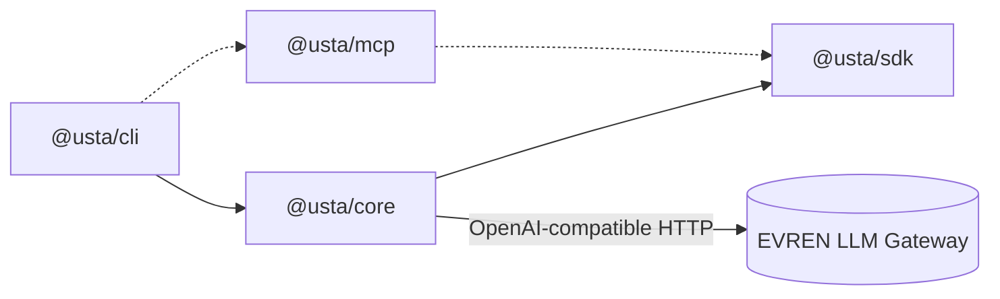
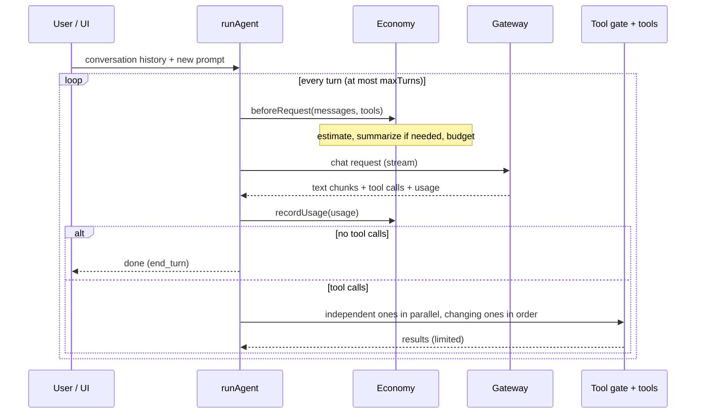
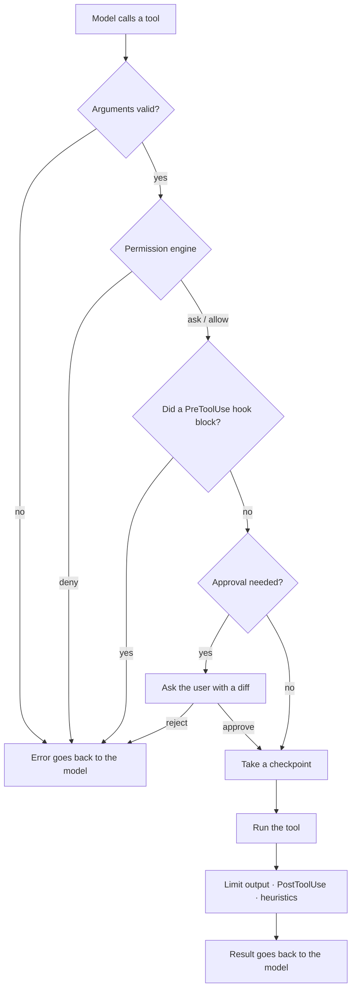

# Architecture

This document describes how usta is built and **why**. Reading it before contributing is recommended; the reasoning behind decisions is recorded in the [ADRs](adr/).

## Packages

| Package      | Responsibility                                                                                                                                              | May depend on        |
| ------------ | ----------------------------------------------------------------------------------------------------------------------------------------------------------- | -------------------- |
| `@usta/sdk`  | **Public API**: `Tool`, `defineTool`, `ToolError`, `ToolContext`, `ReviewRequest`. Plugin/tool authors see only this                                        | `zod` only           |
| `@usta/core` | Everything independent of the UI: agent loop, provider, tools, permission engine, gate, hooks, settings, sessions, checkpoints, token economy, localization | `sdk`                |
| `@usta/cli`  | Ink interface, slash commands, headless mode, the `bin` entry                                                                                               | `core`, `sdk`, `mcp` |
| `@usta/mcp`  | MCP connector client _(M6; empty for now)_                                                                                                                  | `core`, `sdk`        |

**Rule:** `core` knows nothing about the UI (Ink/React). That way the same core feeds the TUI, headless mode and, later, an IDE extension. Everything `core` exposes goes through `index.ts`; `sdk` is the only stable (semver) surface.

## The agent loop

`runAgent` (`core/src/agent/loop.ts`) talks to the model until a single user request is finished.

Important contracts of the loop:

- **Errors go back to the model, they do not crash.** Invalid JSON, an unknown tool, arguments that do not match the schema, a denied permission: all are returned as the tool's _result_ so the model can correct itself.
- **Cancellation is safe.** If the stream is cancelled the half reply is not written to the history; the history is always valid (every tool call has a result).
- **Tool calls arriving as text** (`<tool_call>{…}</tool_call>`) are turned into calls by a fallback parser; some models/servers produce this instead of native `tool_calls`.
- **Read-only calls run in parallel**, changing ones sequentially.
- If a **budget error** is thrown the loop ends cleanly with `stopReason: "budget"`.

Key options: `tools` (an array **or** a function evaluated every turn), `approve` (before every call), `review` (a tool's batch-write approval), `beforeRequest`, `volatileTail`, `limitOutput`, `afterTool`, `onMessage` (persistence), `state` (cache shared between tools).

## The tool contract (`@usta/sdk`)

| Field                 | Meaning                                                                                        |
| --------------------- | ---------------------------------------------------------------------------------------------- |
| `name`, `description` | Goes to the model. Must be **short English**: every tool costs ~110 tokens on every request    |
| `input` (zod)         | Both validation and the JSON Schema for the model; a single source                             |
| `mutating`            | Does it change state? Forbidden in plan mode, needs approval                                   |
| `permission`          | `{ kind: "path" \| "command", target(input) }`: what permission rules match against            |
| `preview?`            | The diff/preview shown in the approval box                                                     |
| `run(input, ctx)`     | `ctx.cwd`, `ctx.signal`, `ctx.state`, `ctx.review`. Throws `ToolError` for an expected failure |

## The tool gate

Every call passes through **one** path (`core/src/gate.ts`); there is no way around it.

For tools that write many files on their own, like `Script`, the gate offers a second channel: `ctx.review`. Before writing, the tool sends the full diff and the file list; `createReviewer` checks each file against the `Edit`/`Write` rules (deny, protected path, outside the working directory), asks the user if needed, and checkpoints the files. Reason: [ADR-0003](adr/0003-script-review-in-tool.md).

The permission engine (`permissions.ts`) behaves like a pure function: the same rules and input give the same decision. That is why it is the most heavily tested module.

## The token economy layer

`Economy` (`core/src/economy.ts`) gathers a conversation's token management in one place:

| Part                                       | File              | Job                                                           |
| ------------------------------------------ | ----------------- | ------------------------------------------------------------- |
| `ModelRegistry`                            | `models.ts`       | Window, price, capabilities from `/v1/models`; cached on disk |
| `TokenEstimator`, `GatewayTokenCounter`    | `tokens.ts`       | Calibrated estimate, exact count via `count_tokens`           |
| `CostTracker`, `checkBudget`, `fetchQuota` | `cost.ts`         | Usage, cache ratio, budget, `/v1/quota`                       |
| `compactMessages`                          | `compaction.ts`   | Summarizing older turns                                       |
| `createOutputLimiter`                      | `output-limit.ts` | Shorten big output and write it to disk                       |
| `BulkEditNudge`                            | `nudge.ts`        | Bulk-edit heuristic                                           |

The UI (`cli`) builds `Economy` and wires its callbacks (`callbacks`) to its own needs (show a warning, ask about the budget, save a summary). The accounting logic is in the core, not in the UI.

## Subagents

Under `core/src/agents`: `definitions.ts` (built-in and custom `agents/*.md` agents, trust digest), `runner.ts` (`runSubagent`: `runAgent` in a fresh context), `manager.ts` (`TaskManager`: queue, concurrency, background, notices) and `task-tool.ts` (`Task`, `TaskOutput`).

- **Isolation:** A subagent's messages, tool list (`resolveAgentTools`), state (`state`) and read cache belong to it; only the `formatReport` output returns to the main conversation.
- **Shared gate:** `runSubagent` builds `createToolGate`/`createReviewer` with the same `PermissionEngine`; in the background no `ask` is given, so a call that needs approval is denied. Foreground questions are collected into one queue with `serializeAsk`.
- **Concurrency:** `TaskManager` uses a counting semaphore (at most 3) and a separate lock (1) for writer-capable agents.
- **Cost:** `Economy.trackSubagentUsage` adds usage to the session totals but does not touch the main context's measurement; `subagentGuard` checks the budget.
- **Delivery:** A finished background task is added to the conversation through `pendingMessages` at the start of the next turn via `drainNotices()`.

Reasoning and measurements: [ADR-0007](adr/0007-subagents.md).

## MCP

`packages/mcp`: `config.ts` (`~/.usta/mcp.json` plus the project file behind the trust gate, `${VAR}` expansion) and `manager.ts` (`McpManager`: connects with the SDK client and turns each remote tool into a `Tool` via `adaptTool`). Tools carry the server's schema in `Tool.jsonSchema`; `mutating` defaults to true and `readOnlyHint` only affects whether the user is asked. The CLI connects at session start (`loadSessionMcp`), adds the tools to `tools` and closes on exit. Rationale: [ADR-0009](adr/0009-mcp.md).

## Auto mode

Under `core/src/auto`: `rules.ts` (local dangerous-pattern and read-only lists), `classifier.ts` (`AutoClassifier`: input narrowing, the `models.fast` call, circuit breaker, audit log), `factory.ts` (wiring to the session), `report.ts` (`/auto`).

- **Engine → gate:** in `auto` mode `PermissionEngine.decide` returns `classify` instead of "ask"; `createToolGate` takes it to the classifier. `deny`, protected paths and `ask` rules finish before the classifier.
- **Fail closed:** with no classifier, an error, or anything but `safe`, the call goes to the user (denied if nobody can be asked).
- **Circuit breaker:** after 3 in a row / 10 in total `risky`/`unsure` verdicts the gate switches the mode to `default` and warns.
- Subagents share the classifier through `SubagentRuntime.auto`.

Rationale and measurements: [ADR-0008](adr/0008-auto-mode.md); user guide: [Auto mode](auto-mode.md).

## Localization (i18n)

Every piece of text in usta falls into **one of two classes**, and this split is the foundation of the design:

| Class            | Examples                                                                                                                                 | Language                        | Where it lives               |
| ---------------- | ---------------------------------------------------------------------------------------------------------------------------------------- | ------------------------------- | ---------------------------- |
| **User-facing**  | UI text, approval boxes, `doctor`/`terms` output, slash command descriptions, reports (`/cost`, `/context`), warnings, command-line help | The user's language (`tr`/`en`) | The catalog: `core/src/i18n` |
| **Model-facing** | System prompt, tool descriptions, **tool results and error messages**, permission/hook denial reasons, summarizer prompt, hints          | **English, fixed**              | Plain strings in the code    |

Model-facing text is not tied to the language because (1) the model must behave the same in every language, (2) Turkish costs more tokens, (3) the prompt prefix has to stay byte-for-byte identical for the cache ([ADR-0005](adr/0005-stable-prompt-prefix.md)). Reasoning and alternatives: [ADR-0006](adr/0006-localization.md).

**The catalog.** `en.ts` is the source and defines the key set (`MessageKey`); `tr.ts` is a `Record<MessageKey, …>`, so **a missing key breaks the build**. `t(key, {params})` fills `{name}` placeholders; for plurals a `{one, other}` form is selected by `{count}` (`Intl.PluralRules`). Tests check that both catalogs have the same keys and the same placeholders and that no text is empty.

**Two-faced decisions.** When a text must go both to the model and to the user (e.g. a denied tool call), the source produces an English `reason` and a translatable `reasonKey`: the permission engine carries both in `Decision`, the gate in `ApprovalVerdict`. The loop sends the English to the model and puts the user-language version into the `tool_result` event as `display`; the UI shows `display`.

**Language selection** is done by `detectLanguage` ([Configuration → Language](configuration.md#language)); `setLanguage` changes one piece of module-level state, so `/lang` takes effect at once. Lines already printed do not change, new drawings use the new language.

**Adding a message:** add the key to `en.ts` first, `tr.ts` is then completed with the compiler's help, and use `t("key", {…})` in code. Do **not** put model-facing text into the catalog.

## Persistent data formats

**Session** (`~/.usta/sessions/<id>.jsonl`): each line is a JSON object, append-only.

| `type`     | Meaning                                                                            |
| ---------- | ---------------------------------------------------------------------------------- |
| `meta`     | First line: `id`, `cwd`, `createdAt`, `model`                                      |
| `message`  | A conversation message (`user`/`assistant`/`tool`)                                 |
| `truncate` | `/rewind`: keep the first `length` messages                                        |
| `compact`  | Automatic/manual summary: the first `keepFrom` messages were replaced by `summary` |

The loader replays the lines in order; it ignores a half-written last line and drops a trailing tool-call turn that has no results. The system prompt is not stored (it is generated fresh when continuing). The API key is masked before writing.

**Checkpoint** (`~/.usta/checkpoints/<id>/index.json`): per turn `{messageCount, prompt, files: [{path, backup|null}]}`; the backups are `*.bak` next to it. `backup: null` means "the file did not exist" (it is deleted on rewind).

## The interface (Ink)

- **`<Static>`** prints finished items (user/assistant/tool) once; only the streaming text, the approval box and the input are redrawn (prevents flicker).
- Streaming text is updated every 50 ms; the last 20 lines are shown, and it is rendered as markdown when finished.
- Approval (`pending`) and the budget question (`confirm`) are separate states; while one is open the input is disabled and keys go to the box.
- Pasted text arrives as one chunk and newlines inside it are _not a submit_.
- On long lines the prefix icons (`›`, `●`) are protected with `flexShrink={0}` (otherwise Yoga truncated them).

## Test strategy

| Layer            | How                                                                                                                                                                                              |
| ---------------- | ------------------------------------------------------------------------------------------------------------------------------------------------------------------------------------------------ |
| Unit             | Vitest. Pure modules (permission engine, parsers, economy) directly; temporary directories for the file system                                                                                   |
| Agent loop       | **Scenario** tests with `MockProvider`: model replies are written in advance, requests are recorded and checked (which message, which tool list, which prefix)                                   |
| Interface        | `ink-testing-library`: keystrokes are sent, screen text is awaited. Text and Enter are written separately (because of paste handling)                                                            |
| Real environment | Unit tests cannot catch layout bugs, so interface changes are also verified by hand in a **pty** against the real gateway (example: the banner truncation on a long path was only seen that way) |

When the main agent and a subagent share one fake provider the order of requests races; tests route requests by system prompt. No test needs a real API key or the network; gateway calls are tested with a fake `fetch`.

## Design principles

1. **Safe defaults, fail closed.** When unsure, ask or deny; never allow silently.
2. **`deny` is above everything.** Mode, hook, trust, heuristics: none can override it.
3. **Model-facing text is stable and short** (English); user-facing text is localized ([Localization](#localization-i18n)).
4. **Measure, then decide.** Token and behavior decisions are made with real measurements and written into an ADR.
5. **The core is independent of the UI**, the extension surface is small and versioned.
6. **No telemetry.** Data only goes to the user's gateway.
