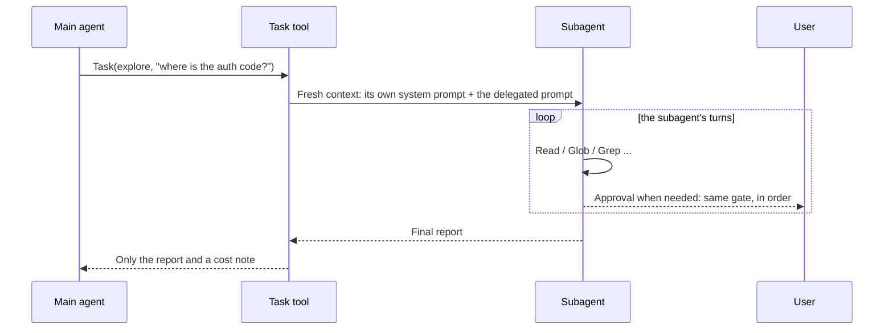
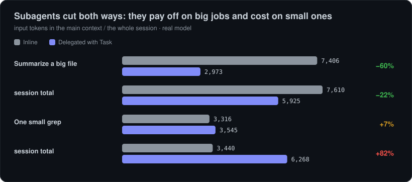

# Subagents and background tasks

When a job needs a wide exploration or an independent sub-task, usta can hand it to a **subagent that works in its own context**. The subagent uses its tools, and the main agent only sees its **final report**. So intermediate output (files read, search results) does not fill the main context, and independent jobs run **in parallel**.

## How it works



The main agent sees two tools:

| Tool         | Input                                                                | What it does                                                                                                 |
| ------------ | -------------------------------------------------------------------- | ------------------------------------------------------------------------------------------------------------ |
| `Task`       | `description`, `prompt`, `agent?` (default `general`), `background?` | Starts a subagent. In the foreground it returns the report; with `background: true` it returns an id at once |
| `TaskOutput` | `id`, `wait_seconds?`                                                | Returns the status and report of a background task; `wait_seconds` waits for it to finish                    |

If several `Task` calls are made in the same turn, **read-only subagents run in parallel** (at most 3 at a time).

## Built-in agents

| Agent     | Tools                                                  | Model         | What for                                                             |
| --------- | ------------------------------------------------------ | ------------- | -------------------------------------------------------------------- |
| `explore` | `Read` `Glob` `Grep`                                   | `models.fast` | Fast read-only search and exploration; a short report with file:line |
| `plan`    | `Read` `Glob` `Grep`                                   | main model    | Read-only research; a numbered implementation plan                   |
| `general` | everything except `Task`, `TaskOutput`, `ExitPlanMode` | main model    | Self-contained multi-step jobs                                       |

Every agent's prompt is fixed English; its final message is the **only thing** the main agent sees. Subagents cannot call `Task` (no nested delegation).

## Permissions and approval

A subagent does not set up a separate security regime; it goes through **the same permission gate as the main session**:

- The mode (plan mode included), `allow`/`deny`/`ask` rules, hooks and checkpoints apply to every tool of the subagent too. In plan mode even `general` cannot write.
- You can restrict which agents may be used with rules: `deny: ["Task(general)"]`.
- If a **foreground** subagent needs approval, the box names the agent (`Permission required (general): Write(a.txt)`). Even when many subagents ask at once, **only one box is open at a time** and the questions are answered in order. If you cancel the run, the ones still queued are denied.
- A **background** task cannot ask the user: a call that needs approval is **denied** (it runs if a rule or the mode allows it).
- While an agent that can change files (like `general`) runs, other writer-capable agents **wait in the queue**; two agents never edit at the same time.
- The budget applies to subagent requests too: if it would be exceeded, the subagent stops (it cannot ask).

## Background tasks

```
usta> scan every use of models.ts in the background, I'll fix the test meanwhile
```

- The task starts at once and gets an id such as `t1`; the status bar shows `⚙ 1 task`.
- A notice appears on screen when it ends. **Its report reaches the model with your next message (or in the main agent's next turn)**; the model can also fetch it with `TaskOutput`.
- `/tasks` lists them all, `/tasks show <id>` shows the report (without affecting delivery to the model), `/tasks stop <id>` stops one.
- Running tasks are stopped when you quit. Tasks are not kept across sessions.
- In headless mode (`-p`) nobody could receive a notice, so `background` is ignored and the task runs in the foreground.

## Custom agents

Define your own agent as a Markdown file:

```markdown
---

name: reviewer
description: reviews a diff for bugs and risky changes
tools: Read, Glob, Grep, Bash
model: main
maxTurns: 12
---

You review code changes for correctness bugs and risky edge cases.
Run `git diff` with Bash, read the touched files, and report concrete findings
with file:line references. Do not modify anything.
```

| Field         | Meaning                                                                                                                                                                                                |
| ------------- | ------------------------------------------------------------------------------------------------------------------------------------------------------------------------------------------------------ |
| `name`        | Required. Lowercase letters, digits, `-`; at most 40 characters                                                                                                                                        |
| `description` | A short English description so the model knows when to pick the agent (listed in the tool description)                                                                                                 |
| `tools`       | Allowed tools, comma-separated. Empty means read-only (`Read, Glob, Grep`). `*` or `all` = everything. `Task`, `TaskOutput`, `ExitPlanMode` cannot be given; an unknown tool is dropped with a warning |
| `model`       | `fast`, `main` or a model id (default `main`)                                                                                                                                                          |
| `maxTurns`    | 1–50 (default 20)                                                                                                                                                                                      |
| body          | The agent's system prompt (required)                                                                                                                                                                   |

Files are read from these places; **a later one with the same name overrides an earlier one** (built-in < user < project):

1. `~/.usta/agents/*.md` (user)
2. `<project>/.usta/agents/*.md` (project)

> **Project agents are behind the trust gate.** An agent that comes from a repository is an instruction that steers the model plus a tool list; so, like [project settings](configuration.md#project-trust-gate), it is **not loaded until you approve its exact content**. At startup the agents' names, tools and models are listed and you are asked; approval is bound to the files' digest (SHA-256) and you are asked again if the content changes. In CI, if you trust them, use `--trust-project`.

## Cost: when to use it

<p align="center"></p>


A subagent is not free: the `Task` and `TaskOutput` schemas go with every request (fixed cost **0.99k → 1.28k tokens**, served from the cache after the first request) and the subagent has its own model turns. Measured with the real model (`qwen3-vl-30b`) on 2026-10-29:

| Scenario                                     | Main context (in / out) | Whole session  | Requests  |
| -------------------------------------------- | ----------------------- | -------------- | --------- |
| Read a big file and summarize it, **inline** | 7406 / 204              | 7406 / 204     | 2         |
| The same with `Task(explore)`                | **2973** / 233          | **5456** / 469 | 4         |
| One `grep` and a summary, inline             | 3316 / 124              | 3316 / 124     | 2         |
| The same with `Task(explore)`                | 3545 / 190              | 5289 / 979     | 4         |
| Two parallel `Task(explore)` in one turn     |                         |                | 6 (2.9 s) |

**Takeaway:** For **large or multi-step** exploration, delegating shrinks the main context markedly (−60% here) and can even be cheaper overall; since the main agent never sees the file, every later request stays lighter too. For **one small search it is more expensive** (the tool schema and a second model turn cost more than the output it keeps out). That is why the main agent's prompt tells it to delegate wide multi-step explorations and independent subtasks, not a single quick search. How the model decides when to delegate is hand-tuned for now; a real comparison belongs to the [M7 evaluation set](roadmap.md).

## Hook and logs

- The **`SubagentStop`** hook runs when a subagent finishes (with `agent`, `description`, `result` fields); it is not blocking. See [Hooks](permissions.md#hooks).
- Each subagent's conversation is written to `~/.usta/subagents/<session>/<task>.jsonl` (0600, API key masked) so you can audit the steps the main agent never saw.

## Limits

- A subagent has no automatic summarization (compaction); its turn limit (default 20) and the output limiter protect it.
- Subagents cannot nest (depth 1).
- At most 3 subagents run at the same time; the rest wait in the queue.
- A subagent's model comes from the same gateway; with a single model today, `explore`'s `fast` model is the same as the main model.
