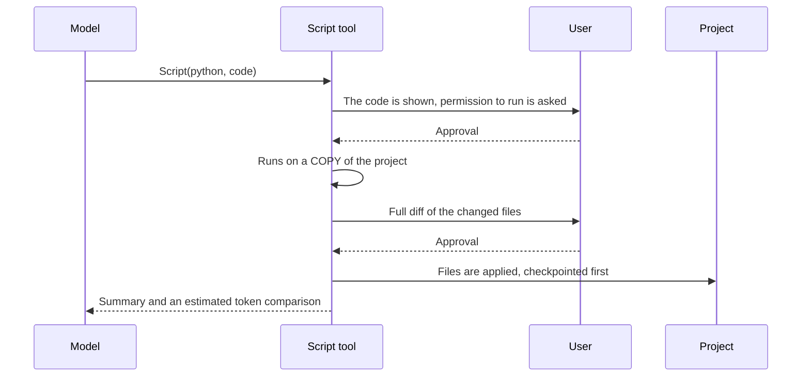

# Token economy

One of usta's design goals is to do the same work **with fewer tokens and fewer model turns**. This page describes the techniques used, the measured results and their limits.

> All numbers were measured with `qwen3-vl-30b`, from the gateway's own `count_tokens` and `usage` values, on 2026-10-29. A real A/B evaluation set is on the [roadmap](roadmap.md) (M7).

## Visibility: what are you spending?

| Command / field | What it shows |
|---|---|
| Status bar | model · mode · context % · ↑input ↓output tokens · cache % · free/remaining CR |
| `/cost` | Requests in the session, tokens, cache hits, price, remaining credit (spent in the session), daily quota, budget |
| `/context` | Breakdown of the context window: system prompt / tools / messages / free. **With the gateway's exact count**; estimated (and labeled) if it cannot be reached |
| `usta -p … --output-format json` | `usage`, `cache_ratio`, `spent_cr`, `remaining_cr` |

```
Context window: 262.1k tokens (qwen3-vl-30b)
  System prompt      253  █
  Tools              797  █
  Messages           548  █
  Free             260.5k  ████████████████████████
Used: 1.6k (1%) · auto-summary threshold 80% · gateway count
```

**The truth about spending is the gateway's balance.** The remaining credit is read from `GET /v1/quota` at startup and after every turn; spent in the session = starting balance − current balance. Price × tokens is only a *pre-estimate* (the price unit is assumed per token from the field name and must be checked against the real balance delta in the paid period). The model is currently free (until its `free_until` date), so CR spending shows 0.

## Token estimation

Before a request is sent, its size is computed with a **calibrated estimate**: the last real `usage` plus an estimate of what was added. The characters-per-token ratio is updated from every response's real `usage`, so it adapts to language (Turkish/code) and works offline. That is why the Qwen tokenizer file (~11 MB) is not shipped: see [ADR-0002](adr/0002-token-counting.md).

## A cache-friendly prompt

The gateway caches the **prefix** of the prompt (`usage.prompt_tokens_details.cached_tokens`). So the start of the prompt stays **byte-for-byte identical** for the whole session:

- The system prompt is built once per session (date included, at session start).
- The tool list is fixed. `ExitPlanMode` enters the list only in plan mode; switching modes costs one cache miss.
- The mode-dependent reminder (plan mode) is not put into the system prompt but appended to the **end** of the request as a temporary message that is not stored in the history.

| Measurement | Result |
|---|---|
| Fixed cost (system + 8 tool schemas) | **1.07k tokens** (1.19k before the improvement) |
| A 2-request turn | 49% from cache |
| A 3-request Script turn | 64% |
| A 6-request session (`/cost`) | 97% |

Reducing the fixed cost: tool descriptions are short English (Turkish costs more tokens), and noise is removed from the JSON schema (`additionalProperties:false`, safe-integer bounds; we validate arguments ourselves anyway).

## Output discipline

The moment a tool output **enters the context** it is billed again on every later request, so large outputs are kept in check:

- **Limiter:** The tool output that enters the context is capped at 12,000 characters by default (60% head, 40% tail). The complete output is written to `~/.usta/outputs/<session>/` and the model can open that path with `Read` (offset/limit). Reading that directory does not ask for permission.
- **Read cap:** `Read` itself stops at 2000 lines / 28,000 characters and says which `offset` to continue from.
- **Read cache:** If the same range of the same file is read again and the file has not changed, the model gets "unchanged, content is above" (no tokens spent again). Summarization or `/rewind` clears the cache, because that content left the context.
- **Memory guard:** `Bash` output is capped while the command runs (1 MB head + 500 KB tail), so a runaway command cannot fill memory.

Measurement: an 80 KB `cat` output was written to disk and the model answered correctly from the tail.

## Context summary (compaction)

If the next request would exceed `compactAt` of the context window (default **80%**), older turns are summarized with `models.fast` and replaced by one message; **the last 2 user turns stay verbatim**.

- If there is one very long agentic turn (no user boundary), the cut is made at an assistant-message boundary; **a tool call is never separated from its result**.
- The summary is written to the session file as a `compact` record, so `usta -c` gives the same result.
- `/compact [focus]` runs it by hand: `/compact focus on the authentication bug`.
- If summarizing fails a warning is shown and the request goes on without a summary (retry after 4 more messages).
- Because the summarizer only sees the *older* part, it is told not to make absolute statements about the whole session such as "only X was done".

## Budgets

```sh
usta --budget 5 --token-budget 200k
```

or `"budget": {"tokens": 500000, "cr": 5}` in settings. It is checked before every request, together with that request's estimated size:

- At 80% it warns once.
- If it would be exceeded it **asks in an interactive session** (answer yes and it does not ask again that session); in `-p` mode it **stops with exit code 3**.
- The token budget is the total tokens processed during the session (including the input re-sent on every request). It also warns when less than 10% of the daily quota is left.

## Script-first: make the same change with one script

When the model would make the same edit in 8 files, it writes one script instead of 8 separate `Edit` calls (each a model turn).



Details:

- **The copy:** `node_modules`, `.git`, `dist`, `build`, `coverage`, `.usta`, `__pycache__`, `.venv`, `venv`, `.next`, `target`, secret files, symlinks and files larger than 1 MB are not copied. Total limit 150 MB, run-time limit 60 s.
- **Two approvals:** first the code (before it runs), then the diff (before it is applied). In `acceptEdits` mode the second is automatic; `deny` rules and protected paths still apply per file.
- **Conflict protection:** if files changed while you were reviewing the diff, **nothing is applied** (all or nothing).
- **Result:** the changed files and an *"by hand ≈ X tokens, by script ≈ Y tokens"* estimate.
- **Heuristic:** If the same change hits ≥ 3 files, or ≥ 6 separate Write/Edit calls are made, a "write one script" hint is added to the next tool result.

> **Security note:** The copy is **not isolation**. The script can reach the network and your home directory; that is why the code is put in front of you for approval before it runs. `python3` and/or `node` must be installed.
>
> **Observation:** A two-tool design (first `Script`, then `ApplyChanges`) was tried with the real model; it did not call the second tool. So approval and applying were merged into one call: [ADR-0003](adr/0003-script-review-in-tool.md).

## Model routing

`models.main` (the main work) and `models.fast` (light work such as summaries) can be set separately; both default to `EVREN_DEFAULT_MODEL`. The gateway currently has one model, so `fast` is only used for summarizing; real routing (search/exploration subagents) arrives with [M5](roadmap.md).
