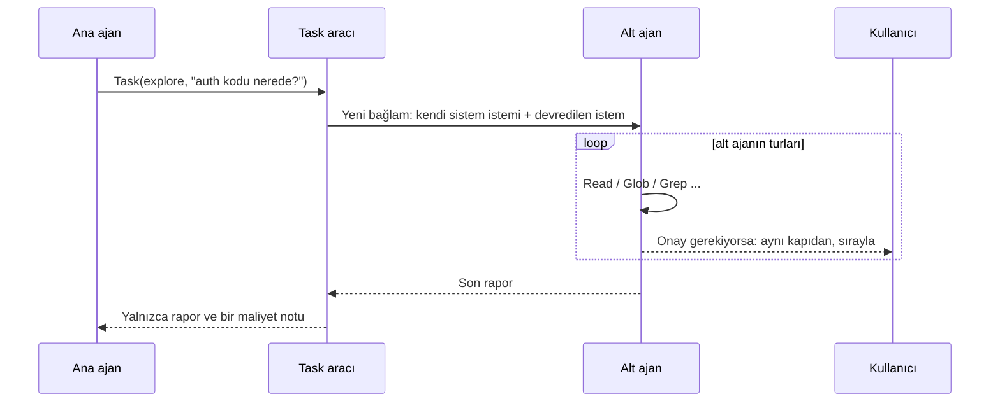

# Alt ajanlar ve arka plan görevleri

Bir iş geniş bir keşif ya da ana işten bağımsız bir alt iş gerektirdiğinde, usta bunu **kendi bağlamında çalışan bir alt ajana** devredebilir. Alt ajan araçlarını kullanır, ana ajan ise yalnızca **son raporunu** görür. Böylece ara çıktılar (okunan dosyalar, arama sonuçları) ana bağlamı doldurmaz ve bağımsız işler **paralel** yürür.

## Nasıl çalışır



Ana ajan iki araç görür:

| Araç         | Girdi                                                                   | Ne yapar                                                                                        |
| ------------ | ----------------------------------------------------------------------- | ----------------------------------------------------------------------------------------------- |
| `Task`       | `description`, `prompt`, `agent?` (varsayılan `general`), `background?` | Alt ajanı başlatır. Ön planda raporu döndürür; `background: true` ise hemen bir kimlik döndürür |
| `TaskOutput` | `id`, `wait_seconds?`                                                   | Arka plan görevinin durumunu ve raporunu verir; `wait_seconds` ile bitmesini bekler             |

Aynı turda birden çok `Task` çağrılırsa **salt okuma yapan alt ajanlar paralel çalışır** (aynı anda en fazla 3).

## Dahili ajanlar

| Ajan      | Araçlar                                         | Model         | Ne için                                                         |
| --------- | ----------------------------------------------- | ------------- | --------------------------------------------------------------- |
| `explore` | `Read` `Glob` `Grep`                            | `models.fast` | Hızlı, salt okuma arama ve keşif; dosya:satır içeren kısa rapor |
| `plan`    | `Read` `Glob` `Grep`                            | ana model     | Salt okuma araştırma; numaralı uygulama planı                   |
| `general` | `Task`, `TaskOutput`, `ExitPlanMode` hariç tümü | ana model     | Kendi içinde bitebilen çok adımlı işler                         |

Her ajanın istemi İngilizce ve sabittir; son mesajı ana ajanın gördüğü **tek şeydir**. Alt ajanlar `Task` çağıramaz (iç içe devretme yok).

## İzinler ve onay

Alt ajan ayrı bir güvenlik düzeni kurmaz; **ana oturumun aynı izin kapısından geçer**:

- Mod (plan modu dahil), `allow`/`deny`/`ask` kuralları, hook'lar ve checkpoint'ler alt ajanın her aracı için de geçerlidir. Plan modundayken `general` bile yazamaz.
- Hangi ajanı kullanabileceğini kurallarla sınırlayabilirsiniz: `deny: ["Task(general)"]`.
- **Ön plandaki** alt ajan onay isterse kutu ajanı etiketler (`İzin gerekiyor (general): Write(a.txt)`). Aynı anda birçok alt ajan sorsa bile **tek seferde tek kutu** açılır, sorular sırayla yanıtlanır. Çalışmayı iptal ederseniz sırada bekleyenler reddedilir.
- **Arka plandaki** görev kullanıcıya soramaz: onay gerektiren çağrı **reddedilir** (kural veya mod izin veriyorsa çalışır).
- Dosya değiştirebilen bir ajan (`general` gibi) çalışırken diğer yazabilen ajanlar **sırada bekler**; iki ajan aynı anda düzenleme yapmaz.
- Bütçe alt ajan isteklerinde de işler: aşılacaksa alt ajan durur (soramaz).

## Arka plan görevleri

```
usta> models.ts'teki tüm kullanımları arka planda tara, ben bu arada testi düzelteyim
```

- Görev hemen başlar ve `t1` gibi bir kimlik alır; durum çubuğunda `⚙ 1 görev` görünür.
- Biten görev için ekrana bildirim düşer. **Raporu, sonraki mesajınızla (veya ana ajanın sonraki turunda) modele iletilir**; model isterse `TaskOutput` ile de alabilir.
- `/tasks` hepsini listeler, `/tasks show <id>` raporu gösterir (modele iletilmesini etkilemez), `/tasks stop <id>` durdurur.
- Uygulamadan çıkınca çalışan görevler durdurulur. Görevler oturumlar arasında saklanmaz.
- Başsız modda (`-p`) kimse bildirimi alamayacağı için `background` yok sayılır ve görev ön planda çalışır.

## Özel ajanlar

Kendi ajanınızı bir Markdown dosyası olarak tanımlayın:

```markdown
---

name: reviewer
description: reviews a diff for bugs and risky changes
tools: Read, Glob, Grep, Bash
model: main
maxTurns: 12
---

You review code changes for correctness bugs and risky edge cases.
Run `git diff` with Bash, read the touched files, and report concrete findings
with file:line references. Do not modify anything.
```

| Alan          | Anlamı                                                                                                                                                                  |
| ------------- | ----------------------------------------------------------------------------------------------------------------------------------------------------------------------- |
| `name`        | Zorunlu. Küçük harf, rakam, `-`; en fazla 40 karakter                                                                                                                   |
| `description` | Modelin ajanı ne zaman seçeceğini anlaması için kısa İngilizce açıklama (araç açıklamasında listelenir)                                                                 |
| `tools`       | İzinli araçlar, virgülle. Boşsa salt okuma (`Read, Glob, Grep`). `*` veya `all` = tümü. `Task`, `TaskOutput`, `ExitPlanMode` verilemez; bilinmeyen araç uyarıyla atılır |
| `model`       | `fast`, `main` veya bir model kimliği (varsayılan `main`)                                                                                                               |
| `maxTurns`    | 1–50 (varsayılan 20)                                                                                                                                                    |
| gövde         | Ajanın sistem istemi (zorunlu)                                                                                                                                          |

Dosyalar şuralardan okunur; **adı aynı olan sonraki, öncekini ezer** (dahili < kullanıcı < proje):

1. `~/.usta/agents/*.md` (kullanıcı)
2. `<proje>/.usta/agents/*.md` (proje)

> **Proje ajanları güven kapısına tabidir.** Repodan gelen bir ajan, modeli yönlendiren bir yönerge ve araç listesidir; bu yüzden [proje ayarları](configuration.md#proje-güven-kapısı) gibi, siz **tam içeriğini onaylamadan yüklenmez**. Açılışta ajanların adı, araçları ve modeli listelenip sorulur; onay dosyaların özetine (SHA-256) bağlanır, içerik değişirse yeniden sorulur. CI'da güveniyorsanız `--trust-project`.

## Maliyet: ne zaman kullanmalı?

<p align="center"></p>


Alt ajan bedava değildir: her istekte `Task` ve `TaskOutput` şemaları gider (sabit yük **0.99k → 1.28k token**, ilk istekten sonra önbellekten gelir) ve alt ajanın kendi model turları vardır. Gerçek model (`qwen3-vl-30b`) ile ölçüm, 2026-10-29:

| Senaryo                                        | Ana bağlam (girdi / çıktı) | Oturum toplamı | İstek      |
| ---------------------------------------------- | -------------------------- | -------------- | ---------- |
| Büyük bir dosyayı oku ve özetle, **satır içi** | 7406 / 204                 | 7406 / 204     | 2          |
| Aynısı `Task(explore)` ile                     | **2973** / 233             | **5456** / 469 | 4          |
| Tek bir `grep` ve özet, satır içi              | 3316 / 124                 | 3316 / 124     | 2          |
| Aynısı `Task(explore)` ile                     | 3545 / 190                 | 5289 / 979     | 4          |
| Aynı turda iki paralel `Task(explore)`         |                            |                | 6 (2.9 sn) |

**Sonuç:** Devretmek, **büyük veya çok adımlı** keşifte ana bağlamı belirgin biçimde küçültür (burada −%60) ve toplamda bile ucuz çıkabilir; ana ajan dosyayı hiç görmediği için sonraki her istek de daha hafif kalır. **Küçük tek bir arama için ise daha pahalıdır** (araç şeması ve ikinci model turu, saklanan çıktıdan fazladır). Bu yüzden ana ajanın istemi, geniş çok adımlı keşifleri ve bağımsız alt işleri devretmesini, tek bir hızlı aramayı devretmemesini söyler. Modelin ne zaman devredeceğine karar vermesi şu an elle ayarlanmıştır; gerçek karşılaştırma [M7 eval setinde](roadmap.md) yapılacak.

## Hook ve kayıtlar

- **`SubagentStop`** hook'u bir alt ajan bittiğinde çalışır (`agent`, `description`, `result` alanlarıyla); engelleyici değildir. Bkz. [Hook'lar](permissions.md#hooklar).
- Her alt ajanın konuşması `~/.usta/subagents/<oturum>/<görev>.jsonl` dosyasına yazılır (0600, API anahtarı maskeli): ana ajanın görmediği adımları denetlemek için.

## Sınırlar

- Alt ajanda otomatik özet (compaction) yoktur; tur sınırı (varsayılan 20) ve çıktı sınırlayıcı korur.
- Alt ajanlar iç içe geçemez (derinlik 1).
- Aynı anda en fazla 3 alt ajan çalışır; gerisi sırada bekler.
- Alt ajan modeli aynı gateway'den gelir; şu an tek model olduğundan `explore`'un `fast` modeli ana modelle aynıdır.
