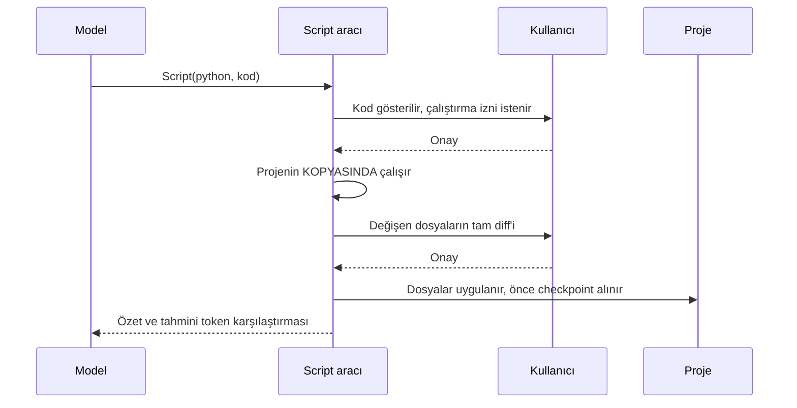

# Token ekonomisi

usta'nın tasarım hedeflerinden biri, aynı işi **daha az token ve daha az model turuyla** yapmaktır. Bu sayfa kullanılan teknikleri, ölçülmüş sonuçları ve sınırlarını anlatır.

> Tüm sayılar `qwen3-vl-30b` ile, gateway'in kendi `count_tokens` ve `usage` değerlerinden, 2026-10-29'da ölçüldü. Gerçek A/B sonuçları: [Değerlendirme raporu](evals.md).

## Görünürlük: ne harcıyorsunuz?

| Komut / alan                     | Gösterdiği                                                                                                                                      |
| -------------------------------- | ----------------------------------------------------------------------------------------------------------------------------------------------- |
| Durum çubuğu                     | model · mod · bağlam % · ↑girdi ↓çıktı token · önbellek % · ücretsiz/kalan CR                                                                   |
| `/cost`                          | Oturum istek sayısı, token, önbellek isabeti, fiyat, kalan kredi (oturumda harcanan), günlük kota, bütçe                                        |
| `/context`                       | Bağlam penceresinin dökümü: sistem istemi / araçlar / mesajlar / boş. **Gateway'in tam sayımıyla**; ulaşılamazsa tahminle ("tahmin" etiketiyle) |
| `usta -p … --output-format json` | `usage`, `cache_ratio`, `spent_cr`, `remaining_cr`                                                                                              |

```
Bağlam penceresi: 262.1k token (qwen3-vl-30b)
  Sistem istemi      253  █
  Araçlar            797  █
  Mesajlar           548  █
  Boş             260.5k  ████████████████████████
Kullanılan: 1.6k (%1) · otomatik özet eşiği %80 · gateway sayımı
```

**Harcamanın gerçeği, gateway'in bakiyesidir.** Kalan kredi `GET /v1/quota` ile açılışta ve her turdan sonra okunur; oturumda harcanan = başlangıç − şimdiki bakiye. Fiyat × token tahmini yalnızca _ön tahmin_ içindir (fiyat birimi alan adından token başına varsayılır; ücretli dönemde gerçek bakiye farkıyla doğrulanmalıdır). Model şu an ücretsizdir (`free_until` tarihine kadar), bu yüzden CR harcaması 0 görünür.

## Token tahmini

İstek göndermeden önce sıradaki isteğin boyutu **kalibre edilmiş bir tahminle** hesaplanır: son gerçek `usage` + eklenen mesajların tahmini. Karakter/token oranı her yanıttaki gerçek `usage` ile güncellenir; böylece dile (Türkçe/kod) uyum sağlar ve çevrimdışı çalışır. Qwen tokenizer dosyası (~11 MB) bu yüzden pakete konmadı: bkz. [ADR-0002](adr/0002-token-counting.md).

## Önbellek dostu istem

Gateway, istemin **ön ekini** önbelleğe alır (`usage.prompt_tokens_details.cached_tokens`). Bu yüzden istemin başı oturum boyunca **bayt bayt aynı** kalır:

- Sistem istemi oturumda bir kez üretilir (tarih dahil, oturum başında).
- Araç listesi sabittir. `ExitPlanMode` yalnızca plan modunda listeye girer; mod değişince tek seferlik önbellek kaçırılır.
- Moda bağlı uyarı (plan modu) sistem istemine değil, isteğin **sonuna** geçici bir mesaj olarak eklenir ve geçmişe kaydedilmez.

| Ölçüm                              | Sonuç                                                                             |
| ---------------------------------- | --------------------------------------------------------------------------------- |
| Sabit yük (sistem + 7 araç şeması) | **0.99k token** (iyileştirme öncesi 1.19k); alt ajan araçları (M5) +0.29k → 1.28k |
| 2 istekli bir tur                  | önbellekten %49                                                                   |
| 3 istekli Script turu              | %64                                                                               |
| 6 istekli oturum (`/cost`)         | %97                                                                               |

Sabit yükün azaltılması: araç açıklamaları kısa İngilizce (Türkçe daha çok token tüketir), JSON şemasından gereksiz alanlar atılır (`additionalProperties:false`, güvenli-tamsayı sınırları; argümanları zaten kendimiz doğruluyoruz).

## Çıktı disiplini

Bir araç çıktısı **bağlama girdiği an** her sonraki istekte tekrar faturalanır; bu yüzden büyük çıktılar kontrol altındadır:

- **Sınırlayıcı:** Bağlama giren araç çıktısı varsayılan 12 000 karakterle sınırlıdır (%60 baş, %40 son). Tamamı `~/.usta/outputs/<oturum>/` altına yazılır ve model bu yolu `Read` (offset/limit) ile açabilir. Bu dizin okuma için izin sormaz.
- **Okuma sınırı:** `Read` kendisi 2000 satır / 28 000 karakterde durur ve devam `offset`'ini söyler.
- **Okuma önbelleği:** Aynı dosyanın aynı aralığı, dosya değişmediyse tekrar okunursa model "değişmedi, içerik yukarıda" cevabını alır (tekrar token harcanmaz). Özetleme veya `/rewind` önbelleği sıfırlar, çünkü içerik bağlamdan çıkmıştır.
- **Bellek koruması:** `Bash` çıktısı çalışırken 1 MB baş + 500 KB son ile sınırlanır; kaçak bir komut belleği doldurmaz.

Ölçüm: 80 KB'lık bir `cat` çıktısı diske yazıldı, model kuyruktan doğru cevabı verdi.

## Bağlam özeti (compaction)

Sıradaki istek bağlam penceresinin `compactAt` oranını (varsayılan **%80**) aşacaksa, eski turlar `models.fast` ile özetlenir ve tek bir mesajla değiştirilir; **son 2 kullanıcı turu aynen kalır**.

- Tek bir çok uzun ajan turu varsa (kullanıcı sınırı yok), kesim bir asistan mesajı sınırında yapılır; **araç çağrısı ile sonucu hiçbir zaman ayrılmaz**.
- Özet oturum dosyasına `compact` kaydı olarak yazılır; `usta -c` ile devamda aynı sonuç gelir.
- `/compact [odak]` elle çalıştırır: `/compact kimlik doğrulama hatasına odaklan`.
- Özetleme başarısız olursa uyarı verilir ve istek özetsiz gider (yeniden deneme 4 mesaj sonra).
- Özetleyici yalnızca _eski_ kısmı gördüğü için "yalnızca X yapıldı" gibi tüm oturum hakkında kesin ifadeler kurmamaya yönlendirilir.

## Bütçe

```sh
usta --budget 5 --token-budget 200k
```

veya ayarlarda `"budget": {"tokens": 500000, "cr": 5}`. Her istekten önce, o isteğin tahmini boyutuyla birlikte kontrol edilir:

- %80'e varınca bir kez uyarır.
- Aşılacaksa **etkileşimli oturumda sorar** (evet derseniz oturum boyunca bir daha sormaz), `-p` modunda **çıkış kodu 3 ile durur**.
- Token bütçesi, oturum boyunca işlenen toplam token'dır (her istekte yeniden gönderilen girdi dahil). Günlük kotanın %10'undan azı kalırsa ayrıca uyarılır.

## Script-first: aynı değişikliği tek betikle yapın

Model 8 dosyada aynı düzenlemeyi yapacaksa 8 ayrı `Edit` çağrısı (her biri bir model turu) yerine tek bir betik yazar.



Ayrıntılar:

- **Kopya:** `node_modules`, `.git`, `dist`, `build`, `coverage`, `.usta`, `__pycache__`, `.venv`, `venv`, `.next`, `target`, gizli dosyalar, sembolik bağlantılar ve 1 MB'tan büyük dosyalar kopyalanmaz. Toplam sınır 150 MB, çalışma süresi sınırı 60 sn.
- **İki onay:** önce kod (çalışmadan), sonra diff (uygulanmadan). `acceptEdits` modunda ikincisi otomatik olur; `deny` kuralları ve korunan yollar dosya bazında yine geçerlidir.
- **Çakışma koruması:** Siz diff'i incelerken dosyalar değiştiyse uygulama **hiç yapılmaz** (hepsi ya da hiçbiri).
- **Sonuç:** değişen dosyalar ve _"elle ≈ X token, betikle ≈ Y token"_ tahmini.
- **Sezgi:** Aynı değişiklik ≥ 3 dosyada ya da ≥ 6 ayrı Write/Edit yapılırsa, bir sonraki araç sonucuna "tek betik yaz" ipucu eklenir.

> **Güvenlik notu:** Kopya bir **izolasyon değildir**. Betik ağa ve ev dizininize erişebilir; bu yüzden kod, çalışmadan önce ayrıca onayınıza sunulur. `python3` ve/veya `node` kurulu olmalıdır.
>
> **Gözlem:** Gerçek modelle iki araçlı bir tasarım (önce `Script`, sonra `ApplyChanges`) denendi; model ikinci aracı çağırmadı. Bu yüzden onay ve uygulama tek çağrıya indirildi: [ADR-0003](adr/0003-script-review-in-tool.md).

## Alt ajanlar: ana bağlamı koruyun

Geniş veya çok adımlı bir keşif, ara çıktılarıyla ana bağlamı doldurur ve **her sonraki istekte yeniden faturalanır**. `Task` aracı bu işi kendi bağlamında çalışan bir alt ajana verir; ana bağlama yalnızca raporu döner.

| Senaryo (gerçek model, 2026-10-29)     | Ana bağlam (girdi) | Oturum toplamı (girdi + çıktı) |
| -------------------------------------- | ------------------ | ------------------------------ |
| Büyük dosyayı oku ve özetle, satır içi | 7406               | 7610                           |
| Aynısı `Task(explore)` ile             | **2973** (−%60)    | **5925**                       |
| Tek küçük `grep`, satır içi            | 3316               | 3440                           |
| Aynısı `Task(explore)` ile             | 3545               | **6268** (daha pahalı)         |

Devretmek büyük/çok adımlı işte ana bağlamı küçültür ve toplamda bile ucuz olabilir; **küçük tek bir arama için daha pahalıdır**. Ayrıca `Task` + `TaskOutput` şemaları sabit yüke ~0.29k token ekler (0.99k → 1.28k; önbellekten gelir). Ayrıntı ve sınırlar: [Alt ajanlar](subagents.md#maliyet-ne-zaman-kullanmalı).

## Model yönlendirme

`models.main` (ana iş) ve `models.fast` (özet ve `explore` alt ajanı gibi hafif işler) ayrı ayarlanabilir; ikisi de varsayılan olarak `EVREN_DEFAULT_MODEL`'dir. Gateway'de şu an tek model olduğundan fark henüz etkisizdir, ama yönlendirme bağlıdır: ikinci bir model eklendiğinde `explore` ve özetleme otomatik olarak ona gider.
