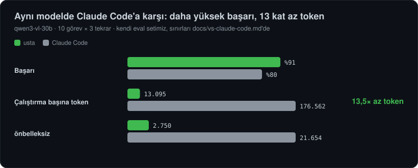

# Aynı modelde Claude Code ile karşılaştırma

<p align="center"></p>

**Kısaca:** EVREN gateway'indeki **aynı model (`qwen3-vl-30b`) ile**, kendi 10 görevlik eval setimizde usta **daha yüksek başarı (%91 ↔ %80)** verdi ve çalıştırma başına **yaklaşık 13,5 kat az token** harcadı (önbelleksiz tokenlarda 7,9 kat). Bu bir "her konuda daha iyi" iddiası **değildir**: aşağıdaki [sınırları](#sınırlar-dürüstçe) ve [Claude Code'un önde olduğu alanları](comparison.md) birlikte okuyun.

## Nasıl ölçtük?

- **Aynı model, aynı gateway:** Gateway Anthropic biçimini de konuşuyor (`/v1/messages`); Claude Code (2.1.312) `ANTHROPIC_BASE_URL` ile EVREN'e yönlendirildi. Gateway Claude Code'un `thinking` parametresini reddediği için (HTTP 400) `MAX_THINKING_TOKENS=0` ile kapatıldı; telemetri ve otomatik güncelleme kapalı.
- **Aynı görevler ve denetimler:** [`evals/`](../evals/README.md) paketindeki 10 görev (4 toplu düzenleme, hata düzeltme, özellik, okuma/cevaplama, inceleme), her biri 3 kez; sonuç otomatik denetlenir ve denetimlerin kendisi test edilir.
- **Ölçü:** başarı, toplam token (istem + tamamlama; önbellekten gelen istem dahil), önbelleksiz token, araç çağrısı, süre. usta için bu sürümün sonuçları kullanıldı.
- **İzinler:** usta eval'i yalıtılmış temp dizinde bypass modunda koştu. Claude Code'un bypass modu (`--dangerously-skip-permissions`) çalıştırma ortamının güvenlik sınıflandırıcısı tarafından reddedildiği için Claude Code **`acceptEdits` ve sabit bir kabuk komutu izin listesiyle** koşuldu (hiçbir izin reddi yaşanmadı).
- **Tur sınırı düzeltmesi (sonradan):** İlk turda her koşu 30 turla sınırlıydı ve Claude Code'un iki toplu görevi (her çağrı ayrı tur) sınıra takılıp başarısız göründü. Bu ikisi 90 tur sınırıyla yeniden koşuldu (6/6 başarı) ve tabloya **onlar** girdi; ham sonuçlar ikisi de depoda.

## Sonuç

|                           |            usta |         Claude Code |
| ------------------------- | --------------: | ------------------: |
| Success                   | **30/33 (91%)** |         24/30 (80%) |
| Tokens per run (total)    |          13,095 | 176,563 (**13.5×**) |
| Tokens per run (uncached) |           2,750 |   21,654 (**7.9×**) |

| Task           | usta ok | usta tokens | usta calls | usta s | Claude Code ok | CC tokens | CC calls | CC s |
| -------------- | ------: | ----------: | ---------: | -----: | -------------: | --------: | -------: | ---: |
| bulk-header    |     3/3 |       5,361 |          2 |      4 |            3/3 |   460,063 |       31 |   28 |
| bulk-version   |     3/3 |       7,970 |          5 |      6 |            3/3 |   312,310 |       22 |   23 |
| fix-bug        |     3/3 |       9,100 |          4 |      5 |            3/3 |    62,141 |        4 |    8 |
| bulk-rename    |     3/3 |      36,316 |         11 |     11 |            3/3 |   550,205 |       33 |   38 |
| big-log-count  |     3/3 |       4,653 |          1 |      1 |            2/3 |    24,158 |        1 |    2 |
| add-feature    |     3/3 |       8,992 |          4 |      5 |            3/3 |    75,395 |        5 |    9 |
| find-answer    |     3/3 |       7,715 |          4 |      2 |            0/3 |    12,050 |        0 |    1 |
| create-cli     |     3/3 |       5,054 |          2 |      4 |            3/3 |    37,037 |        2 |    5 |
| csv-to-json    |     3/3 |       6,542 |          2 |      4 |            3/3 |    53,557 |        3 |   20 |
| review-project |     3/6 |      13,631 |          7 |     16 |            1/3 |    12,253 |        0 |    3 |

_Medyanlar görev başına; üst tablo tüm koşuların ortalamasıdır. Ham veriler: [`evals/results/`](../evals/results/) (`*-claude-code-*.jsonl`). Tabloyu yeniden üretmek: `node evals/compare.mjs`._

## Neden fark çıktı?

- **Sabit yük:** Claude Code her istekte yaklaşık 12 bin token gönderiyor (önbelleğe %88'i okunuyor); usta'nın sistem istemi ve araç şemaları yaklaşık 1,3 bin token. Çok turlu işte bu fark çarpılıyor.
- **Toplu iş için `Script`:** Claude Code dosyaları tek tek düzenliyor (örn. 15 dosyaya başlık: 31 çağrı); usta tek betikle yapıyor (2 çağrı). Bu, [Script A/B ölçümüyle](evals.md) tutarlı.
- **Araç kullanma güvenilirliği:** Bu modelle Claude Code, `find-answer` ve `review-project` görevlerinde **hiç araç çağırmadan** cevap verdi ve dosya adı uydurdu (0/3 ve 1/3). usta'nın istemi bu modelin huylarına göre ayarlı ("önce araçla incele").
- **Çıktı ayrıntısı:** `Grep` sonucu toplam eşleşme sayısını yazıyor (usta); Claude Code'un sayım görevinde 42 yerine 46 dedi.

## Sınırlar (dürüstçe)

- **Ev sahibi avantajı:** Görevleri usta'nın geliştiricisi yazdı ve usta'nın istemi/araçları bu modele ve bu görevlere göre ayarlandı. Claude Code'un araçları ve istemleri Claude modelleri için tasarlanmış; bu karşılaştırma onun asıl kullanım senaryosunu **ölçmez**. Bağımsız biri tarafından yazılmış görevlerle sonuç değişebilir.
- **Küçük örneklem:** 10 görev × 3 tekrar, tek model, tek gün; yüzdeler birkaç puan oynar. usta'nın `review-project` sonucu da yalnızca 3/6.
- **Koşullar tam eşit değil:** farklı izin modları (yukarıda), iki görev için farklı tur sınırı (sonradan, açıkça belirtilerek). Token sayıları Claude Code'un `usage` alanından toplandı (girdi + önbellek oluşturma + önbellek okuma + çıktı).
- **Yalnızca bu model:** EVREN'de başka model yok; güçlü bir Claude modeli ile Claude Code'un sonucu çok farklı olurdu ve bu ölçülmedi.
- **Özellik karşılaştırması değildir:** hafıza, IDE, sandbox, web, olgunluk gibi alanlarda Claude Code **çok daha önde**: [Karşılaştırma ve sonraki adımlar](comparison.md).

## Yeniden üretmek

```bash
pnpm build
# usta
node evals/run.mjs --reps 3 --variants baseline --out evals/results/benim-usta.jsonl
# Claude Code (aynı gateway; CLAUDE_BIN Claude Code'un yürütülebilir dosyası)
CLAUDE_BIN=$(which claude) node evals/run-claude-code.mjs --reps 3 --out evals/results/benim-cc.jsonl
```

`evals/compare.mjs` yayımlanan dosyaları kullanır; kendi sonuçlarınız için dosya adlarını içinde değiştirin. Gateway ayarları `.env`'den okunur; koşular gerçek istek yapar.
